# k8s-inference-autoscaling-benchmark

[](https://github.com/sunilmehta-si/k8s-inference-autoscaling-benchmark/actions/workflows/ci.yml)


[](LICENSE)

**What should a Kubernetes autoscaler follow when it scales LLM inference, and can it hold a latency objective at all?**
This project answers with numbers. It replays the same bursty chat trace through a model of a vLLM deployment, scaled by
the Kubernetes HorizontalPodAutoscaler's own algorithm on four signals (slot utilization, requests in the system, queue
depth, request rate), and measures what users feel (time to first token), what it costs (replica-seconds) and how the
autoscaler behaves (flapping, how long the service was unhealthy). **No GPUs, no cluster and no dependencies are
needed**, and every number is reproducible from a seed.

> **Status: a simulation.** The pod, the queue and the controller are modelled, not measured. The results compare
> settings against one another; they are not benchmarks of a real cluster. [The methodology](docs/methodology.md) says
> what the model includes, what it leaves out and what was chosen before the results. The cluster stage below checks
> the model against the real HPA on a kind cluster.



## The short answer

On a thirty-minute trace with a ramp from 3 to 20 requests per second in 30 seconds and a spike to 40, with a 2 second
first-token objective:

- **No default autoscaler holds the objective.** The best signal, requests in the system, serves 80.3% of requests
  within 2 s. A static pool sized for the peak serves every one, at 24 pods all the time. The autoscaler costs 74% of
  that pool.
- **Requests in the system beat the other three signals at their pre-chosen targets**, in goodput in every one of
  eight runs, and had 1 flap where queue depth had 8. A different target moves a signal a long way,
  so this ranks four settings, not four signals ([why](docs/methodology.md#what-was-decided-before-the-results-and-what-changed-after)).
- **The miss is pod startup first and the delay in deciding second. It is not the target or the scale-up limit.** A
  target of 3 instead of 6 buys 5.5 points of goodput for 20% more cost, and lifting the HPA's +4 pods or doubling limit
  buys 2. Pods that start in 10 seconds instead of 45 buy 7, and deciding every second instead of every 15 buys 2
  more. Only pods that start in one second, with a decision every second, serve every request, at 62% of the static
  pool's cost. A ramp from 3 to 20 requests per second in 30 seconds builds a queue faster than a pod that takes tens
  of seconds to start can drain it, so faster pods (a cached image and model) are worth more than a cleverer signal.
- **Standing headroom is the cheapest lever.** Keeping at least 12 pods instead of 2 lifts goodput to 93.5% for about
  3% more replica-seconds, because the autoscaler scales up to the ceiling during the burst either way.
- **A shorter scale-down window saves a lot and costs a lot.** A 30 second window cuts cost by 41% and flaps 16 times,
  and goodput falls from 80.3% to 64.1%.

| Question | Policy | Goodput | Replica-seconds | Seconds unhealthy |
|---|---|---|---|---|
| [Signal](results/signals/README.md) | `static-24` | 100.0% | 43,200 | 0 |
| [Signal](results/signals/README.md) | `hpa-concurrency` | 80.3% | 32,053 | 215 |
| [Signal](results/signals/README.md) | `hpa-utilization` | 68.7% | 27,893 | 325 |
| [Signal](results/signals/README.md) | `hpa-queue` | 63.7% | 33,521 | 395 |
| [Signal](results/signals/README.md) | `hpa-rps` | 54.0% | 18,469 | 425 |
| [Lower target](results/targets/README.md) | `target-3` | 85.8% | 38,554 | 160 |
| [No scale-up limit](results/scale-up-limit/README.md) | `limit-none` | 82.5% | 32,252 | 175 |
| [10 s pod startup](results/startup/README.md) | `startup-10s` | 87.7% | 29,551 | 115 |
| [120 s pod startup](results/startup/README.md) | `startup-120s` | 64.5% | 34,901 | 420 |
| [Both of those lifts](results/scale-up-limit/README.md) | `limit-none-startup-10s` | 90.0% | 28,742 | 80 |
| [Pods and decisions in 1 s](results/sync-period/README.md) | `instant` | 100.0% | 26,933 | 0 |
| [At least 12 pods](results/warm-pool/README.md) | `min-12` | 93.5% | 33,076 | 65 |
| [30 s scale-down window](results/down-window/README.md) | `conc-down-30` | 64.1% | 18,817 | 430 |

Each cell is the median of eight runs; every run replays its own seeded trace through every policy. The tables behind
each row, with the range over the runs and the differences that held in every run, are in [`results/`](results/).
A test regenerates every table, chart and number on this page from the saved results.

## Policies

| Spec | What it is |
|---|---|
| `static-N` | A fixed pool of N pods. |
| `hpa-utilization` | The HPA on busy slots over slots, target 0.6. What GPU utilization stands in for. |
| `hpa-concurrency` | The HPA on requests in the system (running plus waiting) per pod, target 6. |
| `hpa-queue` | The HPA on requests waiting per pod, target 1. |
| `hpa-rps` | The HPA on requests per second over the last 30 s, per pod, target 1.4. |

Any spec takes options after a colon: `hpa-queue:target=2,down=60,startup=120,min=6`. `iab policies` lists them. The
targets were chosen before any run was compared and were not tuned; the datasets above show what changing one does.

## Quick start

```bash
python3 -m venv .venv && . .venv/bin/activate && pip install -e .      # no dependencies, Python 3.10 or later
iab trace workloads/burst.json                                         # what the trace looks like
iab run workloads/burst.json -p static-24 -p hpa-concurrency -p hpa-queue
iab matrix workloads/burst.json --runs 8 --out /tmp/mine -p hpa-concurrency -p "slow=hpa-concurrency:startup=120"
make test                                                              # the unit tests
make results                                                           # regenerate every dataset; git diff shows any change
```

`iab matrix` writes `runs.json` (every run), `README.md` (the tables) and `chart.svg`. `iab report DIR` renders the
last two again from `runs.json`. A workload is a JSON file of a rate schedule and two size distributions
([burst](workloads/burst.json), [smoke](workloads/smoke.json)); write another to try your own traffic.

## How it works

`workload.py` draws a trace from a rate schedule. `sim.py` is a discrete-event model of pods, slots, one queue and the
pod lifecycle. `policies.py` is the HPA algorithm, step by step, behind four signals. `metrics.py`, `report.py` and
`chart.py` turn runs into the numbers, tables and chart. Everything is deterministic: the same workload, seed and
policy give the same run on any machine and Python version, and the committed results are checked by re-running them.

## Where reactive scaling is enough

Every dataset above uses a ramp from 3 to 20 requests per second in 30 seconds. [`results/ramps`](results/ramps) asks
how slow a ramp must be for the HPA to keep up: four workloads that differ only in how long the same ramp takes (30, 120,
300 and 600 s), eight runs each, with `static-24`, `hpa-concurrency`, `hpa-utilization`, and `cluster-like`, which is
`hpa-concurrency` with a queue per pod and the 30 s metrics lag the cluster has (`make results-ramps`). The policies and
ramps were chosen before the runs.

- **In the model, a ten-minute ramp is slow enough.** `hpa-concurrency` serves 79.5%, 88.0%, 94.6% and 99.2% of
  requests in time on the four ramps (medians), more on each longer ramp in all eight runs, and at 600 s it costs
  46–55% of `static-24`.
- **The best signal depends on the ramp.** `hpa-utilization` is below `hpa-concurrency` on the 30 s and 120 s ramps
  and at or above it on the 300 s and 600 s ramps, in every run.
- **With the cluster's queue per pod and metrics lag, no ramp is slow enough.** `cluster-like` is below
  `hpa-concurrency` in every run on every ramp, and no run serves more than 91.8% in time, even at 600 s. Most of the
  gap is the queue per pod: on the 600 s ramp a queue per pod alone gives 93.2% and the lag alone 97.7% (medians). It
  is not random routing in itself, since `static-24` with a queue per pod serves 99.8%; it is random routing to pods the
  HPA keeps near its target of 6 requests on 8 slots, where one unlucky pod queues while another has room.

[`results/cluster-ramps`](results/cluster-ramps) runs all four ramps on the kind cluster, three seeds each, with
`static-24`, `hpa-concurrency` and `hpa-utilization` (the comparison in the next section), so the model's answer is
checked against the real autoscaler at every ramp.

- **On the cluster, no ramp is slow enough, as the lagged model said.** `hpa-concurrency` serves 73.5%, 82.9%, 89.9%
  and 89.8% of requests in time on the four ramps (medians), below the one-queue model (79.2%, 88.3%, 94.7%, 99.1%) in
  every run, and no run serves more than 92.7%. The model with a queue per pod and the 30 s lag says 70.8%, 80.5%,
  89.8% and 91.1%, within 5.6 points of the cluster on every seed of every ramp and within 2.8 points on the medians.
- **The cluster's gain from a longer ramp stops at 300 s.** From 300 s to 600 s `hpa-concurrency` moves from 89.9% to
  89.8%, while the one-queue model moves from 94.7% to 99.1%; the lagged model moves from 89.8% to 91.1%. A pod queue
  that the HPA keeps near its target holds the share in time at about 90% however slow the ramp.
- **The best signal depends on the ramp on the cluster too, and the flip comes later than the one-queue model says.**
  `hpa-utilization` is below `hpa-concurrency` on the 30 s, 120 s and 300 s ramps (42.8%, 50.5% and 76.8% against
  73.5%, 82.9% and 89.9%) and above it on the 600 s ramp (94.2% against 89.8%, with a shorter tail, 2.3 s against 4.5 s
  at the 95th percentile, at 56–59% of `static-24`'s cost), in every run. The one-queue model puts utilization ahead
  from 300 s; the lagged model puts it behind at 300 s and level at 600 s (91.1% each), so it places the flip where the
  cluster does but misses utilization's lead at 600 s by 2.4–4.1 points. The lagged model is below the cluster for
  `hpa-utilization` on every seed of every ramp, by 2.4 to 21.9 points, so a fixed 30 s lag charges utilization too much.
- **The sampled pipeline places the flip, and utilization's lead, where the cluster does.** With each pod's sample given
  its own age (`scrape=15`, the fourth model of the cluster stage below), `hpa-utilization` is below `hpa-concurrency` on
  the 30 s, 120 s and 300 s ramps and above it on the 600 s ramp (94.7% against 91.6%, with a shorter tail, 2.1 s against
  3.2 s at the 95th percentile), on every seed, as on the cluster. For `hpa-utilization` it says 43.8%, 54.2%, 82.4% and
  94.7% against the cluster's 42.8%, 50.5%, 76.8% and 94.2%, within 11.9 points on every seed and 5.5 on the medians,
  where the fixed lag is within 21.9 and 8.6. For `hpa-concurrency` it says 77.4%, 86.7%, 91.1% and 91.6%, above the
  cluster on every ramp and within 5.3 points on every seed, where the fixed lag is within 5.6 and closer on every
  ramp's median. So the worst case of the pipeline fits requests in the system, and the pipeline itself fits busy
  slots, whose capped steps pay the lag several times over; some delay on the cluster is in neither model.
- **Headroom still wins outright.** `static-24` serves 99.4–99.6% on every ramp on the cluster, as in every model.

## Scaling ahead of the load

Pod startup is the binding constraint, so the next policy orders pods before the load arrives. `predict-SIGNAL` is the
HPA on that signal with a forecast beside it: Holt's linear trend method on the arrival rate, one pod startup (45 s)
ahead, the signal's metric scaled by the rate's forecast growth, and never fewer pods than the HPA asks for, through the
HPA's own bounds, windows and scale-up limit. [`results/predictive`](results/predictive) runs it beside the HPA, a warm
pool of 12 pods and the cluster-like model on the burst and the four ramps, eight runs each (`make results-predictive`).
The policy, its defaults and the dataset were fixed before the runs ([methodology](docs/methodology.md)). It is a model
only: no controller on the cluster forecasts.

- **On requests in the system the forecast pays where a ramp is slow enough for one startup ahead to matter.** On the
  300 s ramp `predict-concurrency` serves 98.4% of requests in time against 94.6% for `hpa-concurrency`, with a shorter
  tail (976 ms against 2,286 ms at the 95th percentile), in every run, and costs less in 6 of 8 runs (15,698 against
  16,536 replica-seconds at the median). On the 120 s and 600 s ramps it serves more in 7 of 8 runs and the same in
  the eighth.
- **On the fastest ramps it changes almost nothing, because the HPA already asks for more than it may add.** On the
  burst and the 30 s ramp, from the ramp's second sync until the pool reaches its 32-pod ceiling, the HPA's own
  recommendation is above the scale-up limit (+4 pods or doubling) in the first run, so the forecast's larger ask is cut
  to the same count and the two make the same decisions through the ramp. `predict-concurrency` serves the same share as
  `hpa-concurrency` in 5 of 8 runs of the burst and 7 of 8 of the 30 s ramp.
- **Standing headroom still wins where the ramp is fast; the forecast is the cheaper lever where it is slow.** `warm-12`
  serves more than `predict-concurrency` in every run on the burst and the 30 s and 120 s ramps. On the 300 s and 600 s
  ramps the forecast costs less in every run (15,698 against 17,685 and 18,428 against 21,660 replica-seconds at the
  median) and gives up 1.6 and 0.5 points of goodput.
- **On the rate signal the forecast is worth the most, and it is still not enough.** `predict-rps` serves more than
  `hpa-rps` in every run of every workload (71.5% against 54.0% on the burst, 80.4% against 46.8% on the 300 s ramp,
  96.7% against 79.0% on the 600 s ramp), and stays below `hpa-concurrency` in every run of every workload.
- **With the cluster's queue per pod and sampled pipeline, the forecast helps on the slower ramps too, and does not make
  up for the queue per pod.** `predict-cluster-like` serves more than `cluster-like` in every run on the 120 s, 300 s
  and 600 s ramps (86.4%, 93.5% and 94.1% against 84.8%, 90.9% and 91.8%), and stays below the one-queue
  `hpa-concurrency` in at least 7 of 8 runs of every workload.

## The cluster stage

[`docs/cluster.md`](docs/cluster.md): the same policies on the same seeded traces on a kind cluster, with the real
Horizontal Pod Autoscaler, Prometheus and prometheus-adapter in front of simulated vLLM pods, so the model can be checked
against something that is not the model. `iab compare` sets each cluster run beside the simulation on the same seed and
settings. It runs in CI only: the scripts refuse any kubectl context but `kind-iab`.

The first comparison is [results/cluster](results/cluster/README.md): the `burst` workload, four policies, three seeds each,
twelve 30-minute runs. What it shows, and what it does not:

- **Medians and scaling decisions agree, for three policies.** The median first-token latency of `hpa-concurrency`,
  `hpa-queue` and `static-24` is within 60 ms of the simulation, and the first two scale up as many times and to the
  same peak. `hpa-utilization` is the exception: its median first token is 7.7 s on the cluster against 0.28 s in the
  simulation.
- **The tail is worse on the cluster in all 12 runs, and a queue per pod explains much of it.** The simulation's
  default is one shared queue. With `route=pod`, each request goes to a random ready pod and waits in that pod's own
  queue, as behind a Service, and a pod added later cannot take work already queued elsewhere. That moves the
  simulation toward the cluster for three policies: the median 95th-percentile first token of `hpa-concurrency` goes
  from 45 s to 85 s against 121 s on the cluster, `hpa-utilization` from 43 s to 81 s against 165 s, and `static-24`,
  which never scales, from 642 ms to 914 ms against 1,038 ms. For `hpa-queue` it overshoots: 115 s against 88 s.
  A queue per pod does not close the gap on its own.
- **The rest is mostly metrics lag.** The cluster's autoscaler reads each signal through Prometheus, which scrapes every
  15 s, and a recording rule evaluated every 15 s, so it acts on a value up to 30 s old; the simulation saw the exact
  state. With a queue per pod and `lag=30`, the median goodput of every HPA policy is within 3.2 points of the cluster
  (`hpa-concurrency` 75.1% against 76.4%, `hpa-queue` 73.5% against 70.3%, `hpa-utilization` 38.3% against 40.9%), and
  the median 95th-percentile first token of `hpa-concurrency` is 121 s on both. The tail of `hpa-utilization` is still
  shorter in the model (131 s against 165 s). The 30 s comes from the configuration, and a test holds the two together;
  lags of 15 and 45 s fit goodput less well for `hpa-concurrency` and `hpa-utilization`. `static-24` never scales, so
  lag cannot move it, and its remaining 124 ms at the 95th percentile is not explained.
- **Utilization is the signal most sensitive to the lag, and its tail on the cluster sits at about 45 s.** Busy slots over
  slots cannot go above 1, so with a target of 0.6 one decision can grow the pods by at most 1/0.6 of the pods it counts;
  a signal of requests in the system has no ceiling. Each step of a utilization ramp waits for the samples to show the
  last step's pods busy, so the lag is paid again at every step. In the model, 15 s more lag (45 s instead of 30 s)
  lengthens the median 95th-percentile first token of `hpa-utilization` by 36 s (131 s to 167 s, against 165 s on the
  cluster) and of `hpa-concurrency` by 9 s. Goodput still fits 30 s better, so no one fixed lag fits the cluster, likely
  because Prometheus scrapes each pod at its own offset within the 15 s and the controller averages samples of different
  ages. Most of the gap is one seed: on seed 1 the queue peaked at 1,756 requests on the cluster against 1,313 in the
  model, 78 s more at the 95th percentile; seeds 2 and 3 are within 31 s. The next bullet tests the offsets.
- **A fourth model gives each pod's sample its own age.** With `scrape=15` the pipeline is modelled piece by piece: each
  pod is scraped every 15 s at its own offset, as Prometheus spreads its targets; a rule evaluated every 15 s at its own
  offset sums the latest sample of every pod; and the autoscaler reads the latest evaluation. The signal it acts on is
  then between 0 and 30 s old rather than 30 s old every time, and a new pod's first sample arrives within 15 s. On the
  burst it moves the median goodput of `hpa-utilization` from 38.3% to 46.4% against 40.9% on the cluster, and its tail
  from 131 s to 140 s against 165 s; `hpa-queue` from 73.5% to 71.7% against 70.3%; `hpa-concurrency` from 75.1% to
  77.4% against 76.4%. Its largest median gap on the burst is 5.5 points against the fixed lag's 3.2, so the burst alone
  does not choose between the two models; the ramps do (the section above).
- **A queue per pod also gives the cluster's ranking of the signals.** With one shared queue the simulation puts
  `hpa-utilization` second (72.3%) and `hpa-queue` last (64.3%). With a queue per pod it puts `hpa-queue` second (79.9%)
  and `hpa-utilization` last (56.2%), as on the cluster (70.3% and 40.9%), and `hpa-utilization` has a median peak of 26 pods, as
  on the cluster, instead of 32. So the earlier ranking of `hpa-utilization` came from the shared queue, not from the
  signal. The cluster is still worse than either model for that policy, by 15 points of goodput against the queue per pod.

The seven datasets above were run with one shared queue. [`results/pod-queues`](results/pod-queues/README.md) runs them
again with a queue per pod, as behind a Service: pod startup is still the biggest lever, but requests in the system no
longer clearly beat queue depth, standing headroom helps half as much, and a shorter scale-down window saves less.

### KEDA on the same signals

[KEDA](docs/cluster.md#keda-the-other-path) is the other common way to scale on these signals: its operator queries
Prometheus itself, and the autoscaler it creates reads the sum over the pods as an external metric, with no
prometheus-adapter. [results/keda/cluster-burst](results/keda/cluster-burst/README.md) runs the burst under the HPA and
under KEDA on each signal, three seeds each, in one dispatch; each pair has the same signal, target, bounds and window.
Before it ran, [results/keda/model](results/keda/model/README.md) put on record what the controller's arithmetic alone
would change: on concurrency nothing, in all eight seeds; on utilization 1.5 points of goodput (42.5% to 44.0%).

- **The first dispatch put KEDA ahead on utilization on every seed.** Goodput 48.2% against 40.6% (49.2%, 47.1% and
  48.2% against 40.6%, 39.2% and 43.9%), the median first token 2.7 s against 12.7 s, 860 unhealthy seconds against
  1,040, at 7% more replica-seconds (23,975 against 22,500), more in every seed.
- **The same seeds again put KEDA behind on every seed.** A second dispatch,
  [results/keda/cluster-burst-utilization](results/keda/cluster-burst-utilization/README.md), ran the same three seeds
  and settings with a third path beside the two: the HPA reading the same sum from the adapter as an external metric,
  KEDA's arithmetic on the adapter's path. KEDA served 41.3% against the HPA's 43.4% at the median, below it on every
  seed, and the external HPA 44.0%. Between the two dispatches KEDA's own runs moved by 3.0 to 7.9 points, as much as
  the gap that first appeared.
- **So no difference between the paths holds on utilization.** Over both dispatches, six runs each, KEDA's median is
  45.6% and the HPA's 42.4%, with KEDA ahead on every seed once and behind on every seed once. The model's 1.5 points
  are within that spread; three seeds of one dispatch were not enough to see past it, and the first dispatch's reading
  that the path made the difference does not stand.
- **On concurrency and queue no difference held.** KEDA's goodput was worse in two seeds of three on both (concurrency
  77.3% against 76.3% at the median, queue 79.7% against 77.9%), as the model said for concurrency.
- **On the 30 s ramp KEDA was behind on utilization too.** In [results/keda/cluster-ramp-30](results/keda/cluster-ramp-30/README.md)
  KEDA on utilization was worse on every seed (41.0% against 46.4% at the median), by 0.3, 7.5 and 1.3 points. On
  concurrency it was better on two seeds of three (75.8% against 73.8%) and used fewer replica-seconds on all three. The
  HPA's own utilization runs there were 2.1 to 5.0 points above the committed ramp's on each seed, so three seeds of a
  signal this noisy do not settle it either way.
- **The HPA's side of the first dispatch repeats the first cluster dataset.** `hpa-utilization` served 40.6%, 39.2% and
  43.9% against 40.9%, 38.4% and 43.3% in [results/cluster](results/cluster/README.md), within a point on every seed. The
  second dispatch moved it by up to 6.6 points on seed 2, so a match on one dispatch is not a measure of the spread.

## Status

The simulation, its seven datasets, the cluster stage's runner and comparison, the first cluster dataset, a model
with a queue per pod and the cluster's metrics lag that matches its goodput within 3.2 points, four ramps that show
where reactive scaling is enough, all four ramps on the cluster, and a model in which each pod's sample has its own age,
which places the ramps' utilization flip where the cluster does, and KEDA and the external HPA reading the same signals,
are built. Not yet built: a predictive policy.

## Related projects

- [k8s-inference-routing-benchmark](https://github.com/sunilmehta-si/k8s-inference-routing-benchmark): which router should sit in front of vLLM pods, measured on a kind cluster.
- [k8s-gpu-scheduler-benchmark](https://github.com/sunilmehta-si/k8s-gpu-scheduler-benchmark): which Kubernetes GPU scheduler packs the work best.
- [kubernetes-secure-mlops-pipeline](https://github.com/sunilmehta-si/kubernetes-secure-mlops-pipeline): the pipeline that ships a model to production safely.
- [agentic-code-review-tool](https://github.com/sunilmehta-si/agentic-code-review-tool): reviews every pull request here.

## License

MIT, see [LICENSE](LICENSE).
